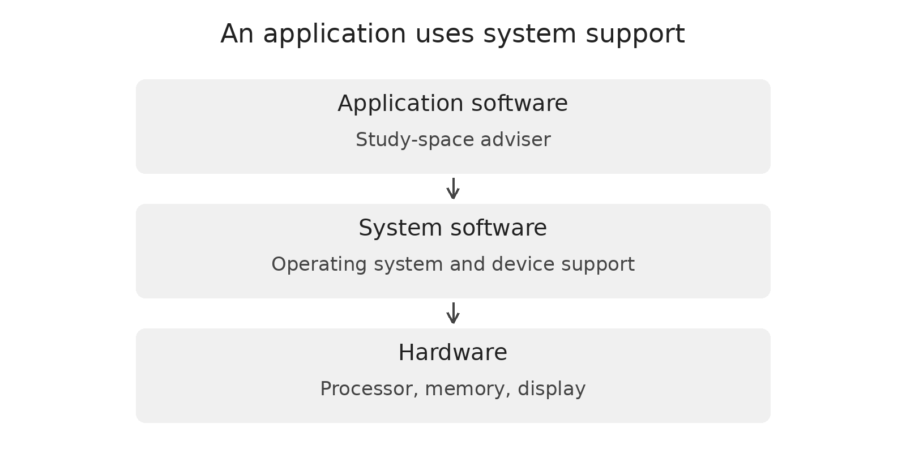
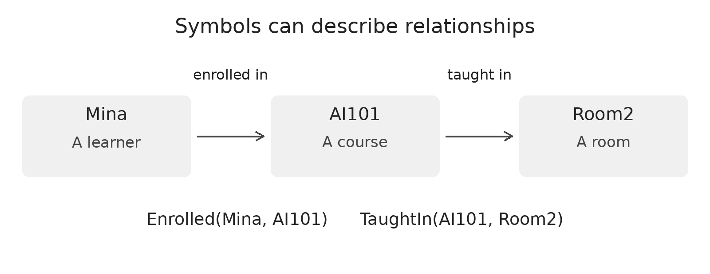
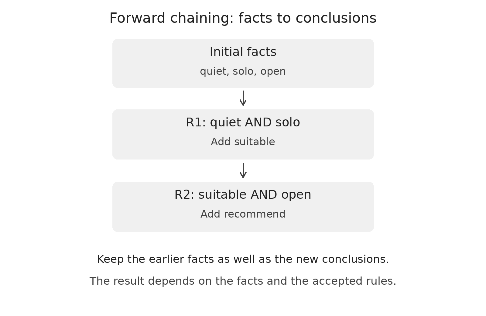
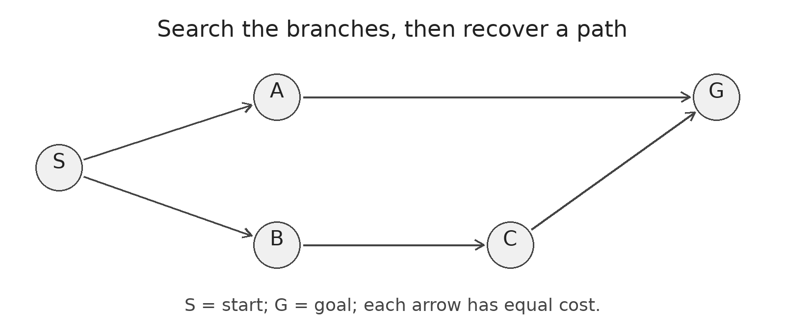
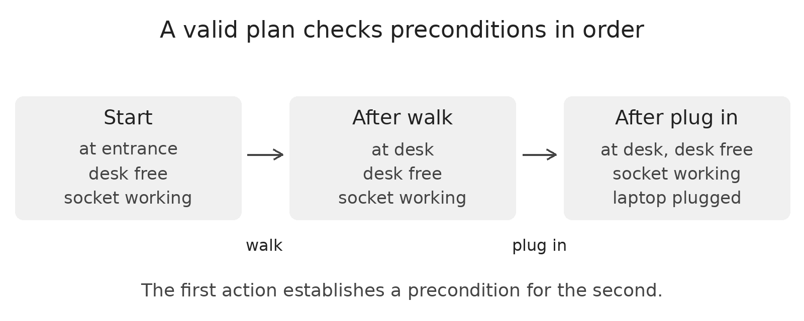
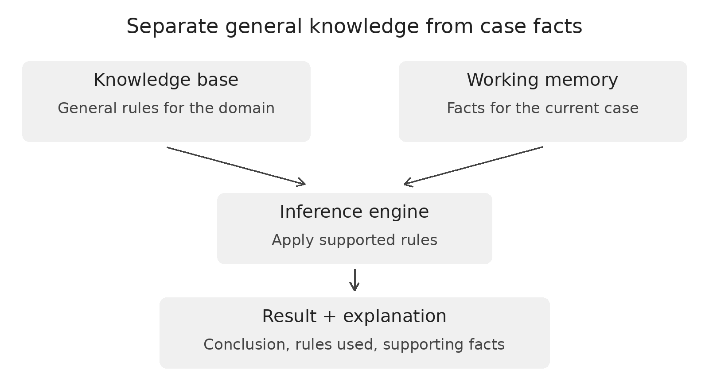

# Software and Symbolic AI

Team DLLM • Exam study edition • Stage 1 content revision 2.0 • 3 November 2026

## How to study this guide

Mina needs somewhere quiet to study. Her adviser receives information about her needs and the rooms. What should it say if nobody knows whether a room is open? You will answer this twice: first as the person designing the software, then as the person writing its reasoning rules.

No programming or formal logic is assumed. Bring a pen. Cover the feedback while you work. After each chapter, answer its quick check without looking back; then use the bank to practise the sections you missed. The questions rehearse this module, not a prediction of the exam paper.

### Contents and outcomes

**Chapter 1 • Software (pp. 2–4).** 1.1 Hardware and software; 1.2 Inputs, processing and outputs; 1.3 Algorithms and programs; 1.4 Requirements and validation; 1.5 Testing and updates. By the end, classify a component, describe what it does, and design a test with an expected result.

**Chapter 2 • Symbolic AI (pp. 5–11).** 2.1 Symbols, facts and predicates; 2.2 Logic and IF–THEN rules; 2.3 Forward and backward chaining; 2.4 Search; 2.5 Planning; 2.6 Expert systems; 2.7 Explanations and limits. By the end, trace a conclusion, identify missing evidence, follow a search, and explain what a small expert system can and cannot establish.

**Development status:** Both chapters are drafted, with worked examples and checks. Team review of this revision is pending. The source outline maps all six V1 topics to these two chapters.

**First pass:** Try the two chapter checks. **Second pass:** Practise the worked traces with the final line covered. **Last pass:** Use the one-page recall sheet, then answer an extended question in your own words.

<!--page-->

# Chapter 1 • Software

## 1.1 Hardware and software

Hardware is the physical equipment. Software is the programs and supporting instructions or data used by a computer. Ask what role an item plays: a keyboard is hardware; the operating system manages resources for other programs; an application performs a task for its user.
| Item | Category | Why |
|---|---|---|
| Phone screen | Hardware | It is a physical part. |
| Operating system | System software | It manages resources such as memory and devices. |
| Study-space adviser | Application software | It helps a person choose a place to study. |

## 1.2 Inputs, processing and outputs

An **input** is information supplied to a program. **Processing** is what the program does with it. An **output** is the result it gives back.

**Worked example:** Mina asks for quiet. The room’s status is unknown. The inputs are her need and the available room information. Processing checks what is known against the recommendation rule. The output is a question: “Is the room open?” A useful output need not be a recommendation.

**Quick check:** A weather app receives a temperature and displays “Below freezing.” Which is the input? Which is the output? **Answer:** The temperature is the input; the displayed message is the output. Comparing the temperature with the threshold is processing.

<!--page-->

## 1.3 Algorithms and programs

An **algorithm** is a precise sequence of steps. A **program** implements steps in a language a computer can execute. **Pseudocode** expresses the steps without requiring exact programming syntax.

**Worked example:** For this simplified exercise, the room already meets Mina’s needs. Only its availability remains to be checked.

~~~text
IF the status is unknown: ask whether the room is open.
ELSE IF the room is closed: do not recommend it.
ELSE: offer the open room as a candidate.
~~~

Try tracing the first input, “unknown.” Only the first branch runs. This prevents the program from treating missing information as evidence that a room is open. The full model in §2.6 also checks room properties.

## 1.4 Requirements and validation

A **requirement** describes what a program should do. **Validation** checks whether supplied inputs are acceptable. An input can pass validation and still be wrong about the real world.

**Example:** “Help the student” is difficult to test. “When availability is unknown, ask for the status before recommending the room” gives a clear condition and an observable result. If a single room is marked both open and closed, our adviser rejects the conflicting input.

### Activity A • Write a testable instruction

**Goal:** Turn a vague wish into a requirement. **Prepare:** Read the three branches above.

**Task:** Rewrite “be helpful” as one IF–THEN instruction for a closed room. Predict the message a learner should see.

**Observe:** Underline the input condition and the output separately. **Reflect:** Could a classmate tell whether the program met your requirement?

**Feedback:** “If the room is known closed, do not recommend it and tell the learner it is closed.” The test input is “closed”; the expected result is no recommendation and a closed-status message.

<!--page-->

## 1.5 Testing and updates

A **test case** pairs inputs with an expected result. Write the expectation from the requirement before running the program. Compare it with the **actual result**. A **regression test** repeats a previous check after a change to catch a returning fault.
| Case | Input | Expected result in this model |
|---|---|---|
| Normal | Suitable room, known open | Offer a candidate. |
| Missing | Suitable room, status unknown | Ask whether it is open. |
| Conflict | Both open and closed | Reject the inconsistent status. |
| Update | Previously open, now closed | Recompute; remove the old recommendation. |

### Activity B • Catch a stale result

**Goal:** Test a change of input. **Prepare:** Copy the last row above.

**Task:** The adviser recommended Room A yesterday. Today it is closed. Write today’s expected result before checking the stored result.

**Observe:** If the old recommendation still appears, record expected and actual outputs side by side. **Reflect:** Why might a single successful test with an open room miss this fault?

**Feedback:** The successful test checks one state. The update test checks a transition. Restarting from current facts removes the unsupported conclusion.

### Chapter 1 quick check

1. Is a room-booking app hardware, system software, or application software? Why?

2. Name one input and one output for Mina’s adviser.

3. What is the difference between a requirement and a test case?

4. A program passes an open-room test. Does that establish correct handling of unknown status?

**Check your answers:** 1. Application software: it performs a user task. 2. Input: availability; output: a candidate or a question. 3. A requirement states the desired behaviour; a test supplies specific inputs and expected results to check it. 4. No. Run a separate unknown-status case with an independently predicted answer.

<!--page-->

# Chapter 2 • Symbolic AI

## 2.1 Symbols, facts and predicates

**Symbolic AI** represents knowledge explicitly and uses operations such as rule application or search to solve a problem. A **symbol** names something in the model. A **fact** is a statement accepted for this case. A **rule** says what may follow if its conditions hold. A **knowledge base** stores represented knowledge.

A **predicate** names a property or relationship. Its argument positions have meanings. In Enrolled(person, course), Enrolled(Mina, AI101) says Mina is enrolled in AI101. Swapping the arguments changes the claim. A **variable**, such as x, is a placeholder.

**Worked example:** Fact: Enrolled(Mina, AI101). Rule: IF Enrolled(x, AI101), THEN CanReadNotes(x). Substitute Mina for x. The condition now matches the fact, so the rule supports CanReadNotes(Mina). It says nothing about whether Mina teaches the course.

**Recall test:** Is Enrolled(Mina, AI101) a rule? **Answer:** No. It states one case. The IF–THEN statement can apply to different students.

<!--page-->

## 2.2 Logic and IF–THEN rules

**AND** requires both inputs. Inclusive **OR** requires at least one, including both. **NOT** reverses a known Boolean truth value. An implication, “IF A THEN B,” allows you to infer B when A is established. B alone does not establish A.
| A | B | A AND B | A OR B | NOT A |
|---|---|---|---|---|
| True | True | True | True | False |
| True | False | False | True | False |
| False | True | False | True | True |
| False | False | False | False | True |

**Worked example:** IF student THEN library access. Mina has access. Does that prove she is a student? No: a visitor might also have access. But if you know Mina is a student, the rule supports access.

**Common exam mistake:** An absent fact and a false fact differ. If the file does not say “open,” this adviser cannot conclude “closed.” The truth table above describes known True/False values; missing information describes what the adviser knows.

### Activity C • Read a rule in the correct direction

**Goal:** Apply a rule without reversing it. **Prepare:** Write “ticket AND gate open → may enter.”

**Task:** Try (a) ticket and gate open, (b) ticket only, (c) may enter only. **Observe:** Record what is supported and what remains unknown.

**Reflect:** Could a staff pass also permit entry? **Feedback:** (a) The rule supports entry. (b) The gate condition is missing. (c) Entry alone proves neither a ticket nor an open gate. The rule gives one route to the result.

<!--page-->

## 2.3 Forward and backward chaining

Use this small model of a quiet-room type. Here **quiet** means Mina wants quiet; **solo** means she studies alone; **open** means the room is known open. **Suitable** means the needs fit the assumed room type. **Recommend** means the rules support a candidate.

~~~text
R1: quiet AND solo → suitable
R2: suitable AND open → recommend
~~~

**Forward chaining** starts with facts. Begin with quiet, solo, open. (1) Both R1 conditions hold: add suitable. (2) R2 now has suitable and open: add recommend. (3) No rule adds a new fact: stop. Keep the input facts and do not repeatedly add a conclusion that is already present. R1 and R2 are labels, not priorities.

**Backward chaining** starts with a goal. To support recommend, R2 needs suitable and open. To support suitable, R1 needs quiet and solo. Check the three input facts. This searches for support for a goal; it does not grant the goal just because we want it. In larger searches, track goals already being explored to avoid cycling.

### Activity D • Be the inference engine

**Goal:** Identify the first unsupported step. **Prepare:** Copy R1 and R2. **Task:** Try A: quiet, solo, open; B: quiet, solo; C: solo, open. Start each case fresh.

**Observe:** Record new facts in order, naming each rule. **Reflect:** What should the adviser ask in B?

**Feedback:** A: R1 adds suitable, R2 adds recommend. B: only suitable; ask “Is the room open?” C: R1 lacks quiet; neither conclusion follows. Missing support for a recommendation does not establish its opposite.

**Transfer:** R3 says group AND group_room_open → recommend_group_room. With only group, what is missing? Group_room_open. A rule label identifies the rule; it does not give it priority.

<!--page-->

## 2.4 Search: visited order versus solution path

A **state** is a situation; an **action** moves between states; a **goal** is what you want to reach. The **frontier** holds states waiting to be explored. Breadth-first search (**BFS**) uses a queue: the first state added is the first removed. Depth-first search (**DFS**) follows one branch deeply, using a stack or recursion.

**Worked BFS:** Start at S. Choose A before B, mark states when queued, and check for the goal on removal. Record a parent the first time a state is discovered.
| Remove | Queue after removal and expansion | What changed? |
|---|---|---|
| S | A, B | Both have parent S. |
| A | B, G | G has parent A. |
| B | G, C | C has parent B. |
| G | Stop | Follow parents back to S. |

**Answer:** Removal order is S, A, B, G. The path is S → A → G. There is no edge A → B. DFS choosing B first can find S → B → C → G. BFS gives a fewest-action path here; when action costs are equal, it is also a least-cost path. It need not be the fastest route when travel times differ.

**Try it:** If the two edges on the A route take ten minutes each and the three edges on the B route take one minute each, which is faster? **Answer:** B takes three minutes; A takes twenty. “Fewest edges” and “least time” are different questions.

<!--page-->

## 2.5 Planning: can the next action run?

A **plan** is an ordered sequence of actions. A **precondition** must hold before an action can run. An **effect** changes the state. In our example, a fact not changed by an action stays as it was.
| Action | Must already hold | Change |
|---|---|---|
| Walk to desk | At entrance; desk free | Add at desk; remove at entrance. |
| Plug in | At desk; socket working | Add laptop plugged. |

**Worked example:** Start with at entrance, desk free, socket working. Walk is allowed; now at desk holds and at entrance no longer holds. The socket fact remains. Plug is now allowed, so laptop plugged follows. Reversing the order fails: at desk is missing at the start.

### Activity E • Remove one precondition

**Goal:** Identify precisely where a plan fails. **Prepare:** Copy both actions and the starting state.

**Task:** Remove socket working. Try Walk, then Plug. **Observe:** After each step, list which facts remain and whether the next action is allowed.

**Reflect:** Does being at the desk establish that its socket works? **Feedback:** Walk succeeds. Plug lacks socket working. Ask for that information. The plan has not reached its goal; the missing fact does not prove the socket is broken.

<!--page-->

## 2.6 An expert system checks Room A

An **expert system** applies represented domain knowledge to a case. The **knowledge base** stores general rules. **Working memory** holds current case facts and derived facts. The **inference engine** matches rules and adds conclusions. The **interface** collects inputs and presents the result.

Now drop the quiet-room assumption from §2.3. Distinguish Mina’s needs, quiet and power, from room properties, open_A, quiet_A and power_A. The suffix A refers to Room A.

~~~text
R4: quiet AND power → needs_quiet_power
R5: needs_quiet_power AND open_A AND quiet_A AND power_A → recommend_A
~~~

**Worked trace:** With all five inputs, R4 adds needs_quiet_power. R5 then has all its conditions and adds recommend_A. Remove quiet_A and start fresh. R4 still fires, but R5 cannot. A learner wanting quiet does not prove a room is quiet.

### Activity F • Predict before running

**Goal:** Explain a changed result. **Prepare:** Use the rules above on paper, or run the supplied Python example. **Task:** Compare the full case with the case missing open_A. Then give both open_A and closed_A.

**Observe:** Record the last supported rule and message. **Reflect:** Why reject contradictory status instead of choosing one? **Feedback:** Full: R4 then R5. Missing status: R4 only; ask if open. Conflict: the program rejects the input before reasoning. See the accompanying captured output for all three cases.

<!--page-->

## 2.7 What an explanation can and cannot show

A **reasoning trace** names the facts and rules supporting a conclusion. That makes a recommendation inspectable. The trace cannot verify whether a room is really open or whether the rules cover every learner’s needs. A supported candidate is not a booking.

**Worked example:** Yesterday’s open_A produced recommend_A. Today, remove open_A, add closed_A, and recompute from the current inputs. R4 may still fire, but R5 lacks open_A. Keeping yesterday’s recommendation would be a software fault (§1.5).

A **learned model** fits its behaviour from data. A symbolic rule states an explicit condition. The two can cooperate: a model estimates noise from a microphone, then explicit rules check room constraints. An estimate can be uncertain. A useful improvement is to show when a room fact was last checked and ask for confirmation if it is old.

### Chapter 2 quick check

1. What does Enrolled(Mina, AI101) mean? What would swapping the arguments change?

2. With quiet and solo but no open, what does R1 add? What blocks R2?

3. Why is S, A, B, G not a valid path in the graph in §2.4?

4. Why can R4 fire without quiet_A while R5 cannot?

5. Can a correct trace establish that a room’s status is current?

**Check your answers:** 1. Mina is enrolled in AI101. The first argument is the person, the second is the course; swapping them changes the claim. 2. R1 adds suitable; R2 lacks open. 3. No edge connects A to B. 4. R4 uses learner needs; R5 also needs actual room properties. 5. No. The trace establishes support inside the model; the input still needs verification.

<!--page-->

## One-page recall sheet

Cover the right column. Explain each distinction out loud, then give an example.
| Prompt | What a complete short answer says |
|---|---|
| Hardware / software | Physical equipment / programs and supporting instructions or data. |
| System / application software | Manages resources / performs a user task. |
| Input / process / output | Given data / operations on it / resulting message or action. |
| Algorithm / program | Plan of steps / implementation in a programming language. |
| Requirement / test | Desired behaviour / specific input and expected result. |
| Fact / rule | Statement about a case / condition that supports a conclusion. |
| AND / inclusive OR | All conditions / at least one condition. |
| IF A THEN B | A supports B; B alone does not establish A. |
| Unknown / false | Not established / known not to hold. State the model’s policy. |
| Forward / backward | Start with facts and add conclusions / start with a goal and seek support. |
| BFS / DFS | Queue, shallow states first / pursue one branch deeply. |
| Search order / path | States examined / connected steps from start to goal. |
| Precondition / effect | Needed before an action / changed by the action. |
| Rule base / working memory / engine | General rules / case facts / procedure applying rules. |
| Trace / reality | Explains support inside the model / still check input accuracy. |

**Answer patterns:** Definition: name the term and its distinguishing feature. Rule trace: list inputs → name the rule → give the new fact → state what is blocked. Test: input → expected result → reason. Search: write the queue and path separately.

<!--page-->

## References and optional practice

The guide, card activities and graph are sufficient offline. These selected readings are for clarification, not extra material to memorise. All diagrams and fictional cases are carried forward from the DLLM source, prepared with AI assistance.

**Software:** Harvard CS50x 2025, Lecture 0 notes, “Algorithms” and “Pseudocode.” Use the examples to distinguish a plan from its implementation; write your own three-line room-status algorithm. The longer notes go beyond this module. Offline alternative: §1.3. https://cs50.harvard.edu/x/2025/notes/0/

**Rules and logic:** UC Berkeley CS188, “Propositional Logic” and “Forward Chaining.” Compare one truth-table row and one rule application with §§2.2–2.3. The textbook uses more formal notation. Offline alternative: Activity D. https://inst.eecs.berkeley.edu/~cs188/textbook/logic/propositional.html and https://inst.eecs.berkeley.edu/~cs188/textbook/logic/forward.html

**Search:** UC Berkeley CS188, “Uninformed Search.” Identify the frontier rule for BFS and DFS, then explain the two paths in §2.4. Skip the complexity analysis for this exercise. Offline alternative: the printed queue trace. https://inst.eecs.berkeley.edu/~cs188/textbook/search/uninformed.html

**Planning:** Poole and Mackworth, Artificial Intelligence: Foundations of Computational Agents, first edition, “Forward Planning.” Use it to check preconditions and effects in §2.5. https://artint.info/html1e/ArtInt_206.html

**Expert systems:** CLIPS 6.4 User’s Guide, “Just the Facts” and “Following the Rules.” Our paper model illustrates the concepts; no CLIPS installation or commands are needed. https://www.clipsrules.net/documentation/v642/ug642.pdf
